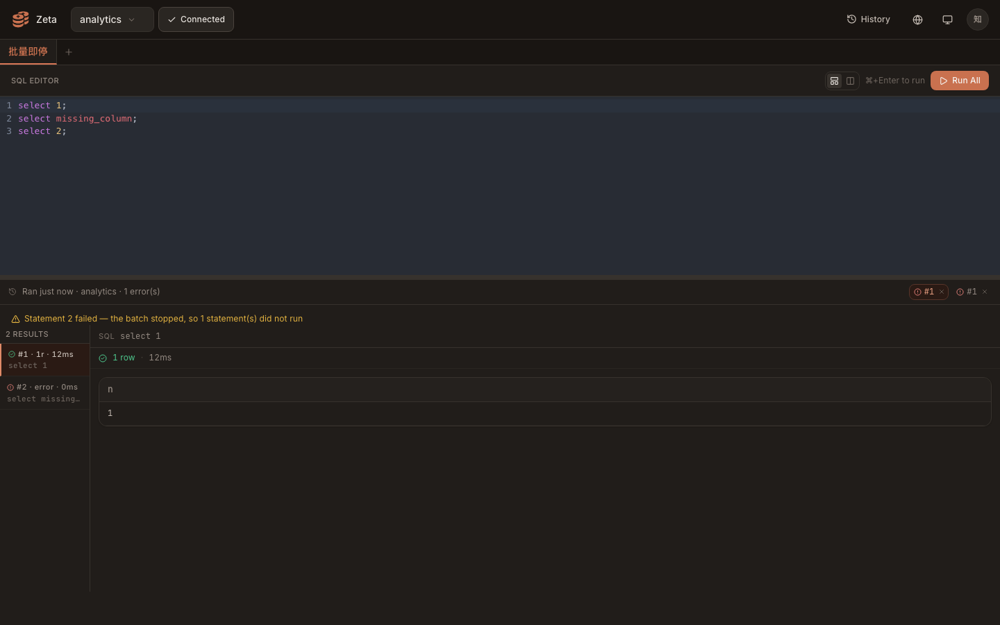
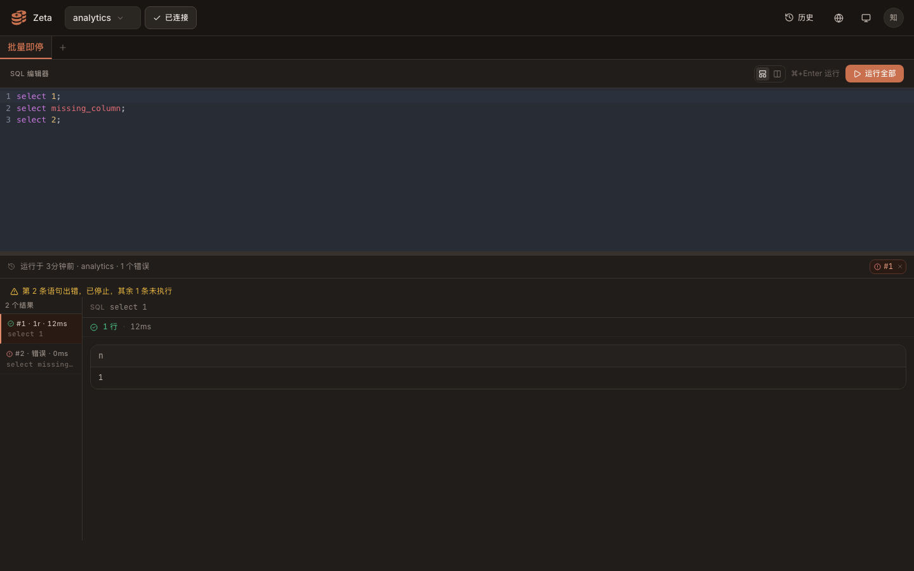

# 批量报错即停 · halted 提示行实测证据

真实浏览器（无头 Chrome，1440×900，DPR 1）+ 本地真后端（`wrangler dev` + 本地 D1，SPA 由 worker 托管）。登录、notebook、数据源、连接探活、运行记录列表与数据库行都是真跑。

**桩（唯一一处）**：`/batch` 响应里的 `halted` 与 run 记录里的 `halted` 由 DevTools 协议 `Fetch` 域按契约回放——`halted` 随后端单落地，前端按同一契约呈现。回放的批量响应为 3 条语句提交、返回 2 条、第 2 条带 `error`、`halted: true`；回放的 run 记录为 `statement_count: 3`、`results` 2 条、`halted: true`（`GET /api/notebooks/:id/runs/:runId`）。历史路径里的 run 行是真库插入的（`zeta_notebook_runs`），只有该行的详情响应由桩补齐 `halted` 字段。

## live 路径：本次批量响应 halted

| 检查项 | 结果 |
| --- | --- |
| 提示行文案（中文） | `第 2 条语句出错，已停止，其余 1 条未执行` |
| 提示行文案（英文） | `Statement 2 failed — the batch stopped, so 1 statement(s) did not run` |
| 提示行位置 | x 16 · y 452 · 1408×17（单行），在结果表格（y 544）之上、历史条（y 412）之下 |
| 结果区 | 2 条结果都在，第 2 条标「错误」，`select missing_column` 的错误文案可见 |
| `role="status"` 数量 | 0（提示行是普通文本行，不与运行态文案抢播报） |

## 历史路径：从运行记录重新打开

页面刷新后没有任何内存缓存，点运行条里的 `#1` 由服务端读回该 run（真库行 + 桩补 `halted`）：

| 记录 | 提示行 | 结果表格 y |
| --- | --- | --- |
| `halted: true`、`statement_count: 3`、2 条结果 | `第 2 条语句出错，已停止，其余 1 条未执行`（y 452） | 544 |
| `halted: false`（同一条 run） | 不出现（`lineRect: null`） | 515（提示行不在时面板上移 29px） |

即停信息随 run 记录走，换浏览器/刷新后打开历史运行同样能看到；记录里没有 `halted`（或数量对不上）时不显示，不编造「其余几条」。

## 自动化

`web` 工作区内：

- `npx vitest run`：18 个文件 / 161 用例全绿（基线 149 + 新增 12：`haltNotice` 取数口径 5 例、`runHaltNotice` 历史记录口径 1 例、pending 携带/清空 2 例、`QueryResults` 提示行呈现 4 例）。
- `npx tsc --noEmit`、`npx tsc -b && npx vite build`：干净。
- 仓库根 `npx biome format web/src`、`npx biome lint .`：干净。
- `translations.test.ts` 的键集对等与「UI 用到的键都有定义」覆盖新增的 `results.halted`（中英齐平）。
