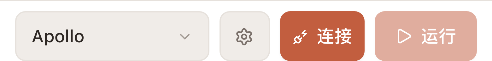

# 页眉三控件缩小到 36px ＋ 收起态徽标移除 · 实测证据

真实浏览器（无头 Chrome 158，1440×900 与 1920×1080，DPR 1；移动 390×844、DPR 2）+ 本地真后端（`wrangler dev` + 本地 D1，SPA 由 `vite dev` 提供，`/api` 走同一 worker）。登录走真表单，数据源是本地 D1 里造的四行：`Workerhub`（应用库，`cf_database_id` 命中 `ZETA_APP_DB_ID`）、`Apollo`（`kind=spark`）、`Bubble`（普通 D1）、`A Rather Long Database Name For Truncation`（截断用）。连接态走真 `/api/query/probe`（D1 目标的探活是本地直接判定，不发外网请求）。

所有数值取自 `getBoundingClientRect()`／`Range.selectNodeContents` 的墨迹矩形，单位 px。

## 三控件几何（1440 与 1920 一致）

| 状态 | 数据源按钮 | 齿轮 | 连接按钮 | 箭头中心距按钮右缘 | 按钮内容未溢出 |
| --- | --- | --- | --- | --- | --- |
| Workerhub（应用库） | 140×36 | — | 100×36 | 18.5 | 是 |
| Bubble（普通 D1） | 140×36 | — | 100×36 | 18.5 | 是 |
| Apollo（Spark） | 140×36 | 36×36 | 100×36 | 18.5 | 是 |
| 长名库 | 140×36 | — | 100×36 | 18.5 | 是 |
| 连接态：连接 / 已连接 / 取消连接 | 140×36 | — | 100×36 | 18.5 | 是 |

箭头中心 18.5 = 距右缘 11 ＋ 边框 1 ＋ 图标半宽 6.5；20 组状态的取值完全相同，换数据源名、配置名、连接态都不移动。

## 数据源按钮

| 检查项 | Workerhub | 长名库 |
| --- | --- | --- |
| 按钮内徽标节点数 | 0 | 0 |
| 名称 `clientWidth` / `scrollWidth` | 72 / 72（完整显示） | 94 / 301（省略号截断，`title` 保留全名） |
| 名称可用宽度 | — | 94 = 140 − 左内边距 12 − 右内边距 32 − 两边框 2 |

Spark 目标的两行结构（36px 高内排布）：

| 行 | 内容 | 墨迹高度 | 距按钮上缘 | 距按钮下缘 |
| --- | --- | --- | --- | --- |
| 主行 | `Apollo` | 17 | 2.6 | 16.4 |
| 次行 9px | `默认配置` | 11 | 22.1 | 2.9 |

两行都在按钮框内，`scrollHeight 34 = clientHeight 34`（无裁切、无溢出）。

## 连接按钮（100×36，定宽不跳动）

| 语言 / 状态 | 文案 | 文案墨迹宽度 | 距左缘 / 距右缘 | 行高 | `scrollHeight = clientHeight` |
| --- | --- | --- | --- | --- | --- |
| zh 未连接 | 连接 | — | 图标 26.2 / 60.8（整块居中） | 1 行 | 36 = 36 |
| zh 已连接 | 已连接 | 42.8 | 38.1 / 19.1 | 1 行 | 34 = 34 |
| zh 悬停 | 取消连接 | 57.1 | 30.9 / 11.9 | 1 行 | 34 = 34 |
| en 未连接 | Connect | 55.8 | 图标 12.6 / 74.4 | 1 行 | 36 = 36 |
| en 已连接 | Connected | 72.3 | 16.9 / 10.8 | 1 行 | 34 = 34 |
| en 悬停 | Disconnect | 74.6 | 15.7 / 9.7 | 1 行 | 34 = 34 |

中文最长标签（取消连接）单行放得下，两侧仍各留 11.9px；英文标签更长，图标被 flex 压到 0 宽——这是 110px 定宽时期就有的既存表现（当时文案还会顶出按钮边框 2.3px），现在文案完整落在按钮内。

## 移动端（390×844）

| 检查项 | Workerhub | Apollo | Bubble |
| --- | --- | --- | --- |
| 数据源按钮高 | 40 | 40 | 40 |
| 齿轮高 | — | 40 | — |
| 连接按钮高 | 40 | 40 | 40 |
| 按钮内徽标 | 0 | 0 | 0 |
| 名称 `clientWidth` / `scrollWidth` | 155 / 155 | 107 / 107 | 139 / 139 |
| 名称单行高度 | 17.5 | 17.5 | 17.5 |

