# 个人资料 / 安全设置 拆页（`/profile` + `/security`）真机视觉与交互验收

审计对象：`683d96e`（PR #224，`feat(web): split profile and security into separate pages` + `fix(web): address review feedback`）。

**验收方式**：真浏览器（系统 Chrome 158.0.8127.37 无头，Playwright 1.65.1 + CDP）+ 真后端（`wrangler dev` 本地 D1 + Vite dev，`/api` 代理到 worker）。没有桩接口、没有假数据：账号、权限、改密、TOTP、Passkey、运行条数、主题色全部是真写真读，落库证据直接查本地 D1 文件（`node:sqlite` 只读直连 `worker/.wrangler/state/v3/d1/miniflare-D1DatabaseObject/*.sqlite`）。

**总计 70 项断言，全部通过（阶段 A 40 / 阶段 B 22 / 阶段 C 8），无失败项、无放水项。**

---

## 0. 环境与口径

| 项 | 值 |
| --- | --- |
| 被测 commit | `683d96e`（分支 `tds/conv-01a203f6-3da6-7b08-b94e-3c010bbe09d8` 已合入 `main`） |
| 前端 | 阶段 A/B：Vite dev `:5173`（源码）；阶段 C：`pnpm build:web` 产物 `web/dist`，由 worker `:8787` 直供（与线上同构） |
| 后端 | `wrangler dev` `:8787` + 本地 D1（`TABLE_PREFIX` 未设 → 默认 `zeta`） |
| 浏览器 | Chrome 158.0.8127.37 无头，1440×900（桌面）与 390×844 / DPR 3（移动） |
| QA 账号 | `qa-split@example.com`（首个注册账号，自动 `admin`），本地一次性数据 |
| 判定口径 | 「代码看着对」不算通过；每条都以真实命令 / 真实页面 / 真实 D1 行为准；静态核查与真机实测分开标注 |

---

## 1. `/profile` 与 `/security` 独立路由与 Tab 激活态

| 编号 | 标准 | 测法 | 结果 | 证据 |
| --- | --- | --- | --- | --- |
| 1.1 | `/profile` 是独立路由，地址栏可直接进入个人资料页 | 登录后直接 `goto /profile`，断言 URL 与页面标题 | ✅ | 阶段 A 1.1：URL=`http://localhost:5173/profile` |
| 1.2 | 在 `/profile` 时「个人资料」Tab 为激活态 | 读两个 Tab 的 computed `border-bottom-width/color` | ✅ | 阶段 A 1.2：个人资料 `2px` `rgb(194,94,63)`（品牌色）；安全设置 `0px` |
| 1.3 | 两个页面按需加载，不互相打包 | 监听 `Profile.tsx` / `Security.tsx` 模块请求数 | ✅ | 阶段 A 1.3：进 `/profile` → Profile 请求 1 次、Security 0 次 |
| 1.4 | `/security` 是独立路由，可直接进入 | 直接 `goto /security` | ✅ | 阶段 A 1.4：URL=`http://localhost:5173/security` |
| 1.5 | 在 `/security` 时「安全设置」Tab 为激活态 | 同 1.2 | ✅ | 阶段 A 1.5：安全设置 `2px` 品牌色；个人资料 `0px` |
| 1.6 | 进入 `/security` 才加载 Security 模块 | 同 1.3 | ✅ | 阶段 A 1.6：Security 请求数 0 → 1 |
| 1.7 | Tab 点击可互相切换且激活态翻转 | `/security` 点「个人资料」 | ✅ | 阶段 A 1.7：URL 变 `/profile`，下边框翻转 |
| 1.8 | 同上，反向 | `/profile` 点「安全设置」 | ✅ | 阶段 A 1.8：URL 变 `/security`，下边框翻转 |
| C1.1 | 生产构建下两页内容各自独立，不串页 | 读两页 body 文本 | ✅ | 阶段 C 1.1：Profile 有 账户/主题色/查询结果保留、无 通行密钥；Security 有 修改密码/验证器应用/通行密钥、无 主题色 |
| C1.2 | 生产构建下激活态规则一致 | 同页对比激活/未激活 Tab | ✅ | 阶段 C 1.2：`/profile` 页 个人资料 `2px`+品牌色 / 安全设置 `0px`；`/security` 页相反 |
| C2.1 | 生产构建仍按路由分包懒加载 | 抓 chunk 请求 | ✅ | 阶段 C 2.1：`AccountLayout-CM-DdQPR.js`、`Profile-DLm6P03U.js`、`Security-TpBYmx1t.js` 各被按需请求 |

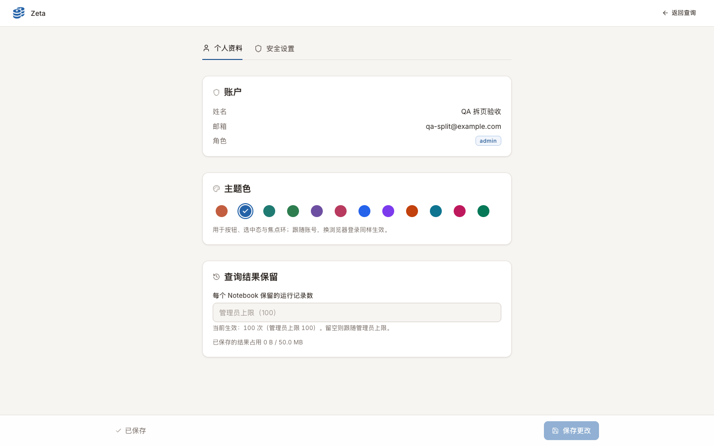

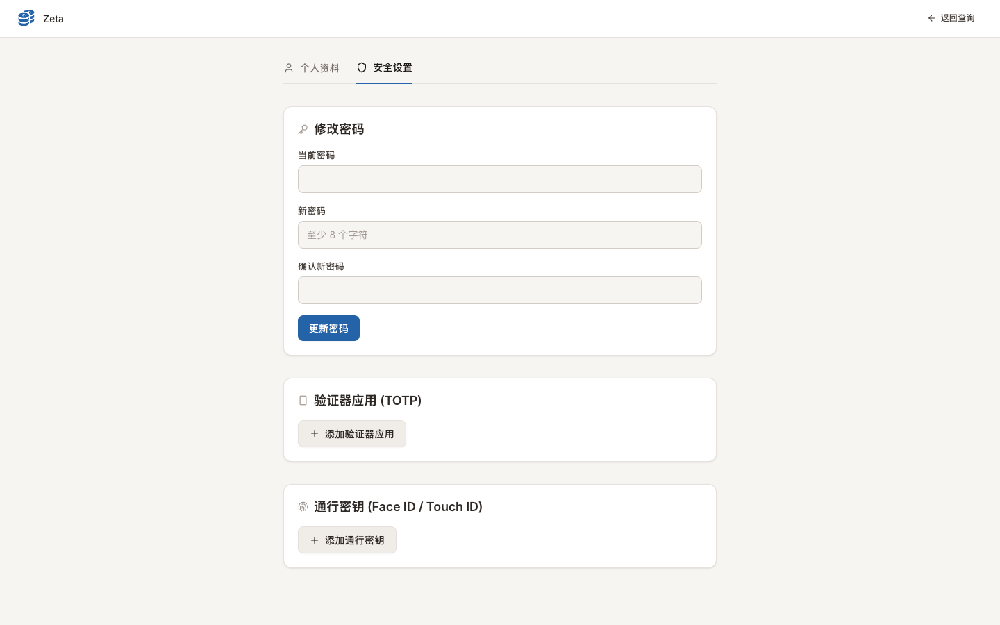

---

## 2. Profile 内容与 `run_limit` 吸底栏（四态 + 非法值拦截）

| 编号 | 标准 | 测法 | 结果 | 证据 |
| --- | --- | --- | --- | --- |
| 2.1 | Profile 只含三块：账户 / 主题色 / 查询结果保留（运行设置） | 页面文本命中判定 | ✅ | 阶段 A 2.1：账户=true 主题色=true 查询结果保留=true |
| 2.2 | Profile 不含任何安全项 | 同上（反向） | ✅ | 阶段 A 2.2：修改密码/验证器应用/通行密钥 均 false |
| 2.3 | 账户卡片只读 | 统计卡片内可交互元素 | ✅ | 阶段 A 2.3：可交互元素数 = 0 |
| 2.4 | 主题色选择器存在，12 个预设色板 | 数色板 radio | ✅ | 阶段 A 2.4：色板数 = 12 |
| 2.5 | 运行条数有独立吸底栏（sticky 吸底） | 读 `section[aria-label="保存设置"]` 的 computed style | ✅ | 阶段 A 2.5：`position: sticky`、`bottom: 0px`，class 含 `sticky bottom-0 … safe-b` |
| 2.6 | 页面只有一个保存入口（无重复保存按钮） | 全页枚举「保存」类按钮 | ✅ | 阶段 A 2.6：「保存更改」按钮数 = 1，全页含「保存」按钮 = 1 |
| 2.7 | 吸底栏态①：初始 clean =「已保存」+ 按钮禁用 | 读 bar 文案与 `disabled` | ✅ | 阶段 A 2.7：`已保存` / disabled=true |
| 2.8 | 吸底栏态②：改动后 =「有未保存更改」+ 按钮可用 | 改输入框后读 | ✅ | 阶段 A 2.8：`有未保存更改` / disabled=false（截图 `profile-sticky-bar-dirty.png`） |
| 2.9 | 吸底栏态③：提交中 =「保存中…」+ 按钮禁用 | 点保存后立即读 | ✅ | 阶段 A 2.9：`保存中…` / disabled=true（截图 `profile-sticky-bar-saving.png`） |
| 2.10 | 吸底栏态④：成功 =「已保存！」+ 按钮回禁用 | 请求返回后读 | ✅ | 阶段 A 2.10：`已保存！` / disabled=true |
| 2.11 | 保存请求体正确 | 拦 `PUT /api/profile/run-settings` 读 body | ✅ | 阶段 A 2.11：PUT 1 次，body=`{"run_limit":25}` |
| 2.12 | 落库生效 | 查本地 D1 `zeta_users.notebook_run_limit` | ✅ | 阶段 A 2.12：`notebook_run_limit = 25` |
| 2.13 | 非法值被前端拦截（不出请求） | 依次输入 `0` / `-1` / `1.5` / `101`，看 `role=alert` 与 PUT 次数 | ✅ | 阶段 A 2.13 四项：均有错误提示「请输入 1 到 100 之间的整数，或留空」，**PUT 次数 = 0**；截图 `profile-invalid-run-limit-0.png` / `-neg1.png` / `-1.5.png` / `-101.png` |
| 2.14 | 合法值可保存并落库 | 输入 30 → 保存 | ✅ | 阶段 A 2.14：`notebook_run_limit = 30` |
| 2.15 | 留空 = 跟随管理员上限（落库 NULL），页面显示当前生效值 | 清空后保存并读页面 | ✅ | 阶段 A 2.15：落库 `NULL`，页面显示「当前生效：100 次（管理员上限 100）」 |
| 2.16 | 主题色即时生效并落库，且不产生脏状态 | 点色板 → 立即看颜色 / PUT / 按钮状态 | ✅ | 阶段 A 2.16：terracotta → ocean 立即生效，PUT `{"theme_color":"ocean"}`，D1=`ocean`，保存按钮仍禁用 |
| 2.17 | 离开页面后 dirty 复位 | 切 Tab 触发确认框 → 离开 Profile → 再点「返回查询」 | ✅ | 阶段 A 2.17：切 Tab 弹「你有未保存的更改，确定要离开吗？」；离开后再点「返回查询」确认框 = null |
| 2.18 | 重进 `/profile` 回到 clean 态 | 重新进入读 bar | ✅ | 阶段 A 2.18：`已保存` / disabled=true |
| C3.1 | 生产构建下吸底栏四态一致 | 延迟 PUT 1.5s 观察中间态 | ✅ | 阶段 C 3.1：已保存 → 有未保存更改 → **保存中…** → 已保存！，落库 `notebook_run_limit = 43` |

---

## 3. Security 内容与「无统一保存栏」

| 编号 | 标准 | 测法 | 结果 | 证据 |
| --- | --- | --- | --- | --- |
| 3.1 | Security 含三块：修改密码 / 验证器应用 / 通行密钥 | 页面文本命中 | ✅ | 阶段 A 3.1：三项均 true |
| 3.2 | Security **没有**统一保存栏 | 数 `section[aria-label="保存设置"]` 与「保存更改」按钮 | ✅ | 阶段 A 3.2：吸底栏数 = 0，「保存更改」按钮数 = 0 |
| 3.3 | Security 不含 Profile 专属内容 | 反向文本 + run_limit 输入框计数 | ✅ | 阶段 A 3.3：主题色=false 查询结果保留=false run_limit 输入框=0 |
| 3.4 | 各项自带动作按钮 | 枚举页面按钮 | ✅ | 阶段 A 3.4：`["更新密码","添加验证器应用","添加通行密钥"]` |
| 3.5 | 改密表单三字段齐全 | 查 DOM | ✅ | 阶段 A 3.5：current/next/confirm 均为 true |
| C4.1 | 生产构建下同样无统一保存栏 | 同 3.2 / 3.4 | ✅ | 阶段 C 4.1：stickyBars=0 saveBtns=0 actions=`["更新密码","添加验证器应用","添加通行密钥"]` |

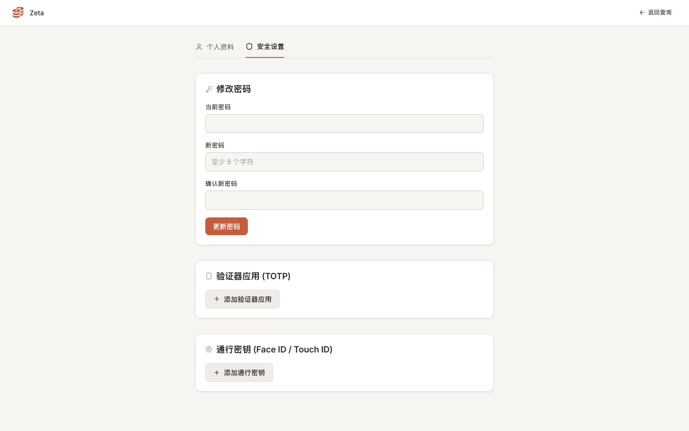

---

## 4. `/profile/security` 防御跳转与 `/account*` 别名清除

| 编号 | 标准 | 测法 | 结果 | 证据 |
| --- | --- | --- | --- | --- |
| 4.1 | 旧地址 `/profile/security` 不 404、不死链，自动落到 `/security` | 直接访问旧地址 | ✅ | 阶段 A 4.1：最终 URL=`http://localhost:5173/security` |
| 4.2 | `/account`、`/account/profile`、`/account/security` 旧别名已不存在 | 三条逐一访问并判定页面内容 | ✅ | 阶段 A 4.2：三条都落到 `/query`，均未渲染 Profile/Security 内容 |
| 4.3 | 源码内无 `/account` 残留路由或链接（静态核查） | `grep -rn /account web/src` | ✅ | 阶段 A 4.3：命中 = 无 |
| C5.1 | 生产构建下同样成立 | 同 4.1 / 4.2 | ✅ | 阶段 C 5.1：`/profile/security` → `:8787/security`；三条 `/account*` → `:8787/query` |

---

## 5. 入口与登录回归（用户菜单 / 改密 / TOTP / Passkey / 移除弹窗 / 2FA 登录）

| 编号 | 标准 | 测法 | 结果 | 证据 |
| --- | --- | --- | --- | --- |
| B1.1 | 用户菜单保留「个人资料」「安全设置」入口 | 点头像读菜单 | ✅ | 阶段 B 1.1：菜单含 `个人资料 / 安全设置`（截图 `user-menu-entries.png`） |
| B1.2 | 「个人资料」→ `/profile` | 点击后读 URL | ✅ | 阶段 B 1.2：`http://localhost:5173/profile` |
| B1.3 | 「安全设置」→ `/security` | 点击后读 URL | ✅ | 阶段 B 1.3：`http://localhost:5173/security` |
| B2.1 | 改密可提交并有成功反馈 | 填当前/新/确认 → 点「更新密码」 | ✅ | 阶段 B 2.1：页面提示「密码已修改」 |
| B2.2 | 改密后旧密码失效 | 用旧密码登录 | ✅ | 阶段 B 2.2：仍停在 `/login`，提示 `Invalid email or password`（截图 `login-old-password-rejected.png`） |
| B2.3 | 改密后新密码可登录 | 用新密码登录 | ✅ | 阶段 B 2.3：登录后进入 `/query` |
| B3.1 | TOTP 添加流程完整（二维码 + 手动密钥 + 验证码框） | 点「添加验证器应用」 | ✅ | 阶段 B 3.1：32 位 base32 密钥 + `data:image/png;base64` 二维码（截图 `security-totp-setup.png`） |
| B3.2 | TOTP 启用后落库 | 查 `zeta_totp_credentials` | ✅ | 阶段 B 3.2：1 行 `name=Authenticator`，`user_id=8c1a99d1-9ac3-41bf-bb0b-d62d31d590e8`（截图 `security-totp-enabled.png`） |
| B4.1 | 移除验证器有二次确认弹窗（标题 + 当前密码 + 取消/移除） | 点「移除」读弹窗 | ✅ | 阶段 B 4.1：「确定要移除此验证器吗？／请输入当前密码以确认。／当前密码／取消／移除」（截图 `security-remove-totp-modal.png`） |
| B4.2 | 弹窗「取消」不删凭据 | 点取消后复核 | ✅ | 阶段 B 4.2：弹窗残留 = 0，凭据行数 = 1（未删） |
| B4.3 | 弹窗「移除」+ 密码确认才删 | 填密码 → 移除 | ✅ | 阶段 B 4.3：页面剩余凭据行 = 0，D1 `zeta_totp_credentials` 计数 = 0 |
| B5.1 | Passkey 走真实 WebAuthn 注册 | Chrome CDP 虚拟认证器（ctap2 / resident key / UV） | ✅ | 阶段 B 5.1：D1 `zeta_passkey_credentials` 1 行 `name=Passkey`（截图 `security-passkey-added.png`） |
| B6.1 | 移除通行密钥有二次确认弹窗 | 点「移除」读弹窗 | ✅ | 阶段 B 6.1：「确定要移除此通行密钥吗？／当前密码／取消／移除」（截图 `security-remove-passkey-modal.png`） |
| B6.2 | 移除后落库清零 | 填密码 → 移除 | ✅ | 阶段 B 6.2：D1 `zeta_passkey_credentials` 计数 = 0 |
| B7.2 | 登出可用 | 菜单「退出登录」 | ✅ | 阶段 B 7.2：落到 `http://localhost:5173/login` |
| B7.3 | 登录回归：密码 + TOTP 两步登录成功 | 登出后用密码 + 当前 TOTP 码登录 | ✅ | 阶段 B 7.3：登录后进入 `/query` |

---

## 6. 移动端 safe-area 吸底栏与布局一致性

| 编号 | 标准 | 测法 | 结果 | 证据 |
| --- | --- | --- | --- | --- |
| B8.1 | 移动端吸底栏跟随刘海屏安全区 | 390×844 / DPR3 / touch，CDP `Emulation.setSafeAreaInsetsOverride {bottom:34}` 后读 computed padding | ✅ | 阶段 B 8.1：`padding-bottom = 34px` |
| B8.2 | 滚到底吸底栏贴视口底部、宽度铺满 | 滚到底后量 `getBoundingClientRect` | ✅ | 阶段 B 8.2：bar 底 = 844 = innerHeight，宽 = 390 = innerWidth，`padding-bottom: 34px` |
| B8.3 | 末项（运行条数输入框 + 保存按钮）完整可见、在安全区之上可点 | 量输入框与按钮矩形 | ✅ | 阶段 B 8.3：保存按钮 760–798px（≤ 844−34），输入框 541–580px（截图 `profile-mobile-safe-area-bottom.png`） |
| B8.4 | 移动端真能保存 | 改值 → 保存 → 读文案 + 拦 PUT + 查 D1 | ✅ | 阶段 B 8.4：dirty「有未保存更改」→ 保存 →「已保存！」，PUT `{"run_limit":60}`，D1 = 60（截图 `profile-mobile-safe-area-saved.png`） |
| B8.5 | 移动端与桌面端吸底栏结构一致 | 对比 computed style 与按钮 class | ✅ | 阶段 B 8.5：两侧均 `position: sticky` / `bottom: 0px` / 内层 `display:flex; align-items:center` / 按钮 class `btn-primary gap-2 shrink-0` / 结构子节点数相同 |
| C6.1 | 生产构建下移动端同样正确 | 同样注入 safe-area 34px | ✅ | 阶段 C 6.1：`padding-bottom=34px`，bar 底 = 844 = innerHeight，宽 = 390（截图 `profile-production-build-mobile-safe-area.png`） |

---

## 7. 附图（关键证据）

吸底栏 dirty 态（「有未保存更改」+ 保存按钮可用）：

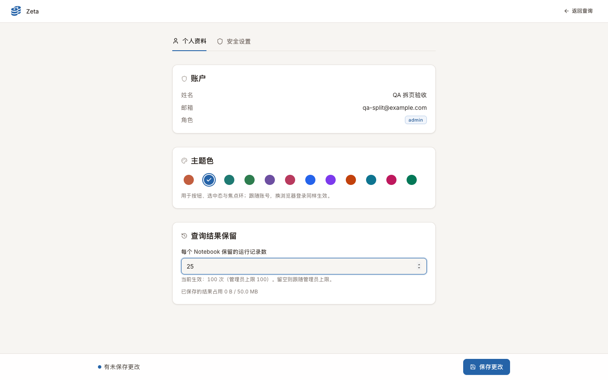

吸底栏 saving 态（「保存中…」+ 按钮禁用）：

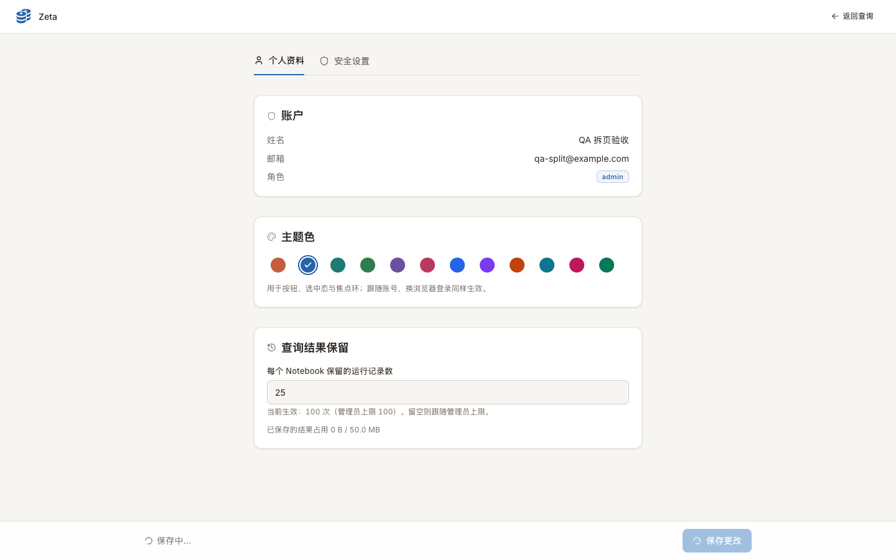

非法值拦截（提示「请输入 1 到 100 之间的整数，或留空」，不发保存请求）：

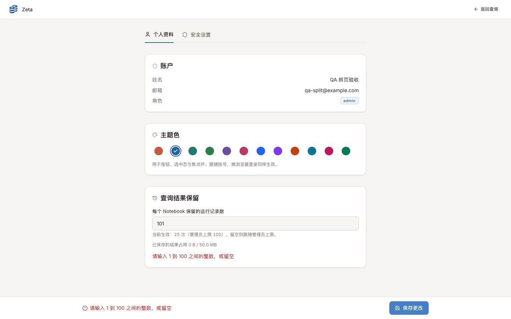

移除验证器 / 通行密钥的二次确认弹窗：

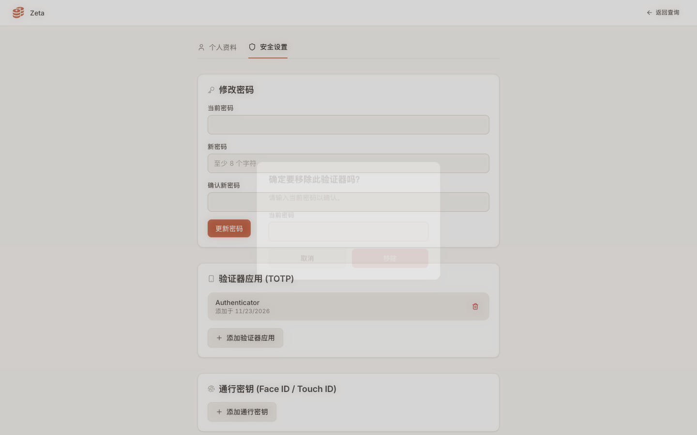

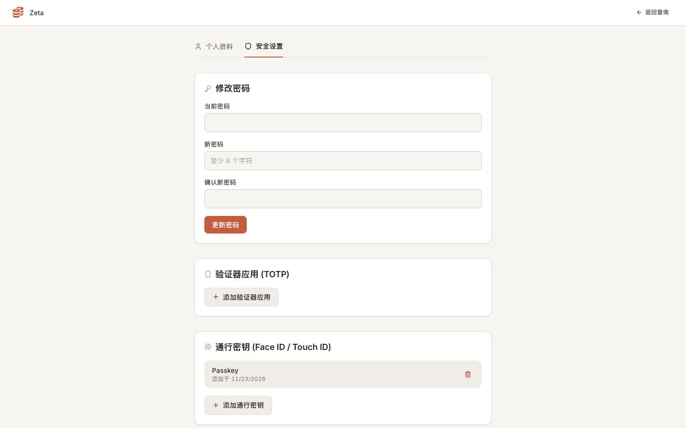

TOTP 添加（二维码 + 手动密钥）与 Passkey 注册成功：

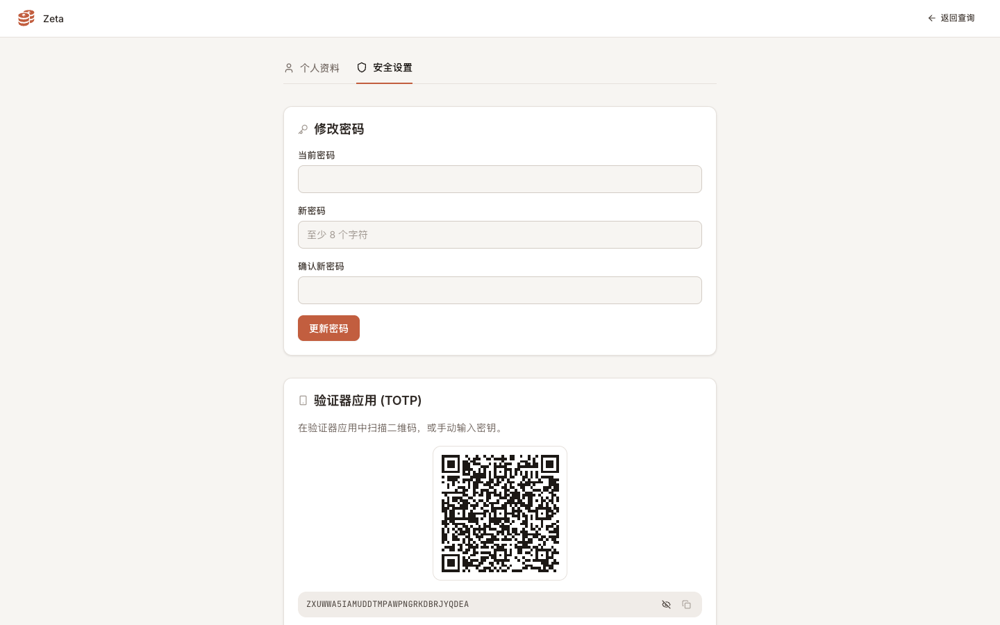

改密后旧密码登录被拒：

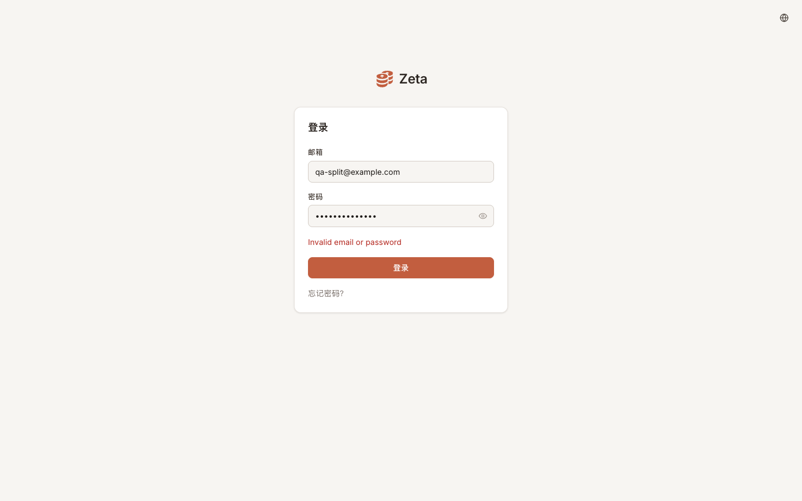

移动端 390×844 底部（吸底栏贴底，按钮上方留出 34px 安全区）：

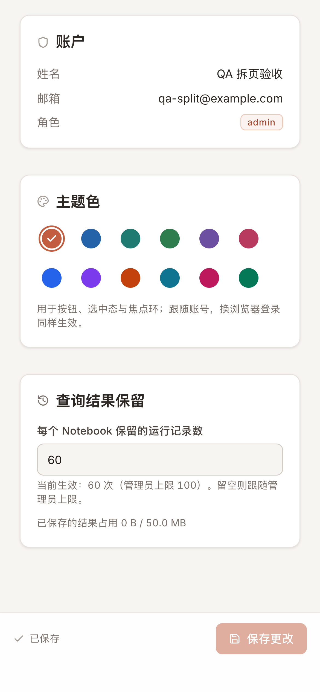

生产构建（worker 直供 `web/dist`）的吸底栏与移动端安全区：

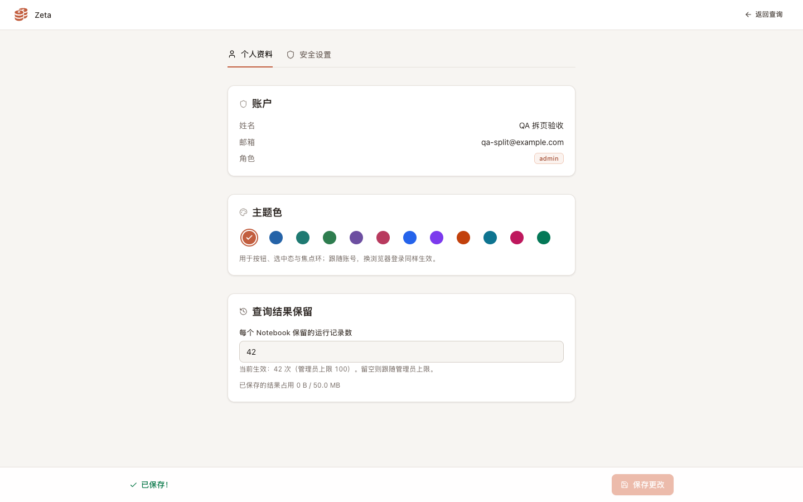

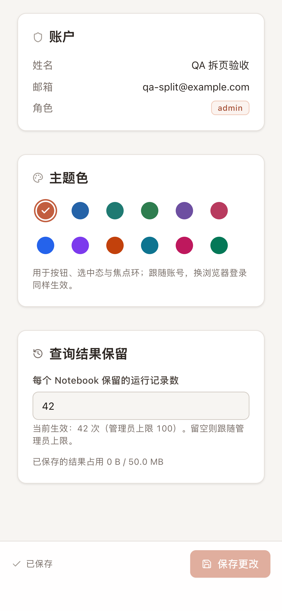

---

## 8. 观察项（不构成阻断，记录在案）

| 观察 | 事实 | 判定 |
| --- | --- | --- |
| Vite dev 下偶发掉登录态 | `web/src/main.tsx` 用了 `React.StrictMode`，dev 下 effect 双调用会并发发两次 `POST /api/auth/refresh`；同一 refresh cookie 第二次因令牌轮换被拒 → 前端清会话跳回 `/login`。同一段导航序列实测（阶段 C 6.2）：生产构建 5 次 refresh、**401 = 0、掉登录态 = 0**；Vite dev 13 次 refresh、**401 = 3、掉登录态 = 3** | 开发模式产物，生产构建不复现；QA 脚本以「检测到 /login 即重登」处置（阶段 A 自愈 2 次、阶段 B 3 次、阶段 C 1 次），不改产品代码 |
| 注册在首个账号后自动关闭 | 首个账号注册成功后 `POST /api/auth/register` 返回 `403 {"error":"Registration is disabled"}` | 产品既定行为（`worker/src/routes/auth.ts` 注释即如此），非缺陷 |

---

## 9. 复现方式与夹具

- 脚本：[`profile-security-split/`](profile-security-split/README.md)（`phase-a.js` / `phase-b.js` / `phase-c.js` / `reset-fixture.js`），结果 JSON 落在 `/tmp/zeta-qa/ps-results-{a,b,c}.json`。三个脚本均已用归档版本实测复跑（40/22/8 全绿），并做了可重复性加固：登录时探测候选密码（阶段 B 会轮换密码）、运行条数目标值动态取「与当前不同」（否则前端不会进入脏状态）、TOTP 验证码被防重放时等待下一个 30 秒窗口、阶段 A/C 启动时清理本地 TOTP 凭据、`d1()` 查询出错时打印 SQL 与错误而不是静默返回 null。
- 环境：`worker` 8787（`wrangler dev` + 本地 D1）+ `web` 5173（Vite）；阶段 C 额外用 `pnpm build:web` 产物由 worker 直供。
- 夹具：全部数据在本地一次性 D1（账号 `qa-split@example.com`），不触生产；`worker/.dev.vars` 为本地 QA 密钥（gitignored，未提交）。
- 本次验收未改动任何产品代码（`web/`、`worker/` 源码零修改），未合并、未部署、未写生产数据。
