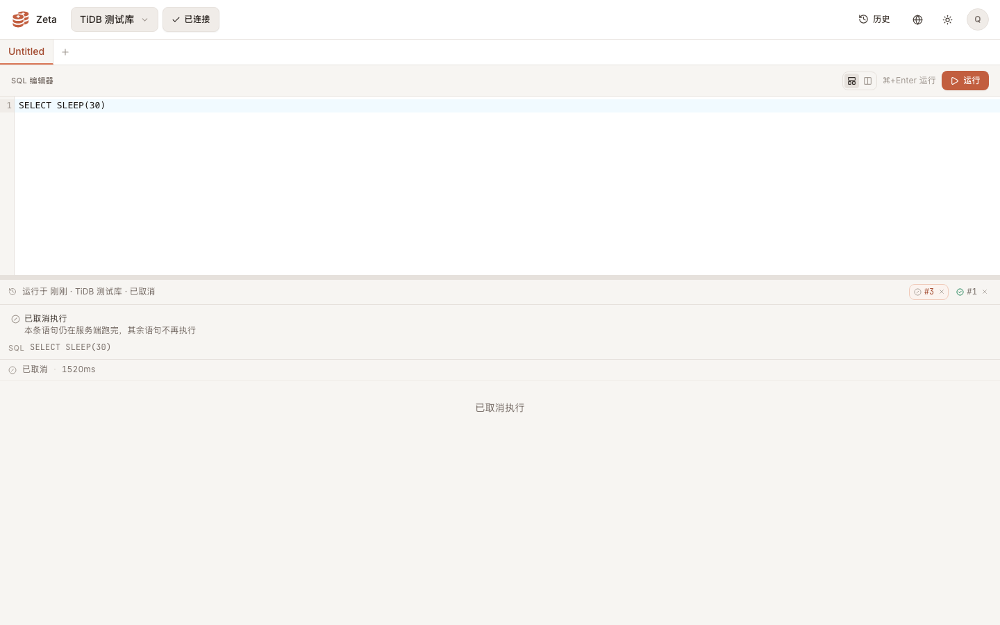
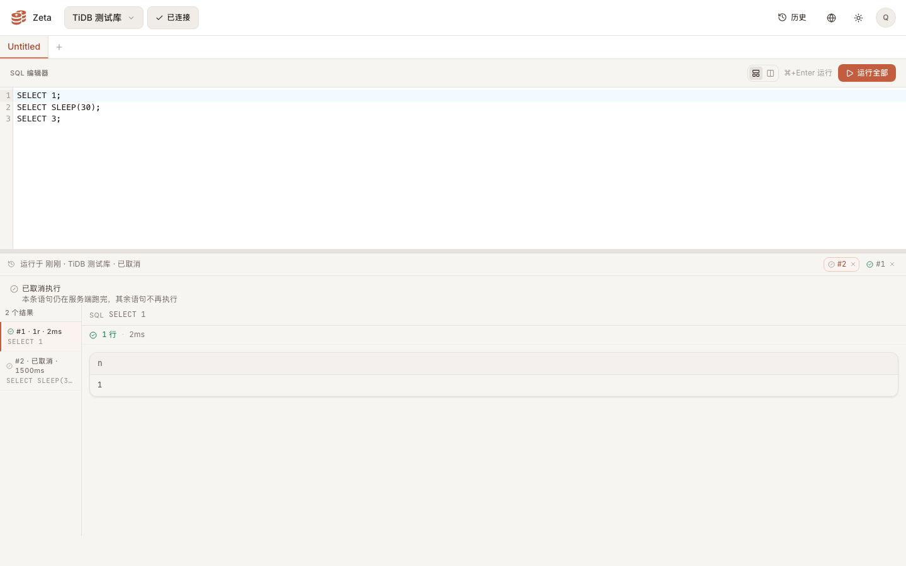
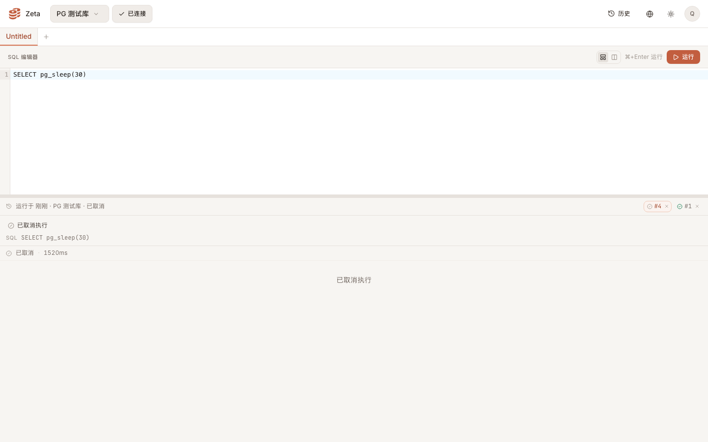
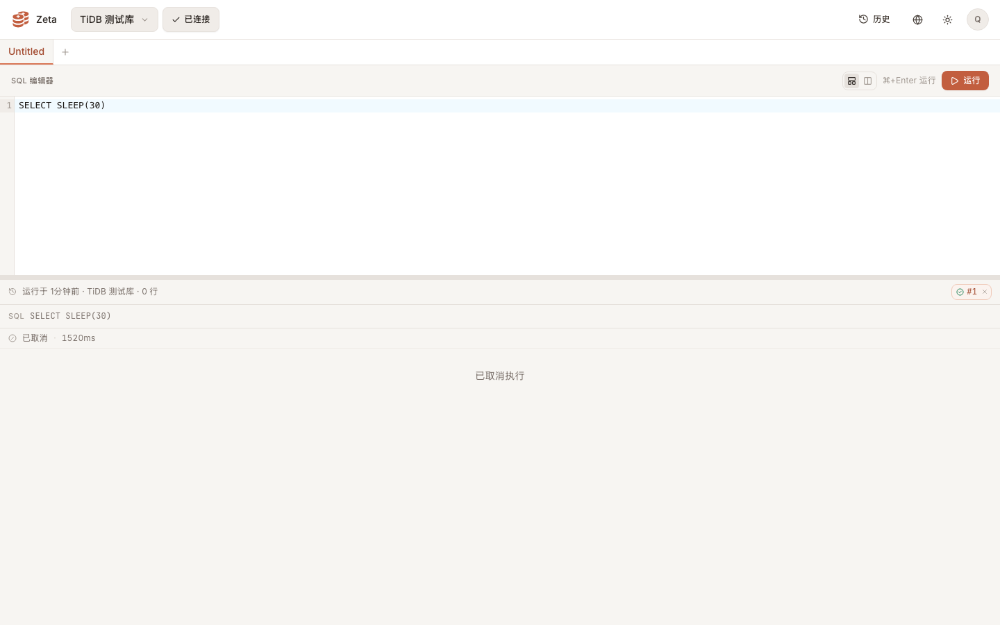
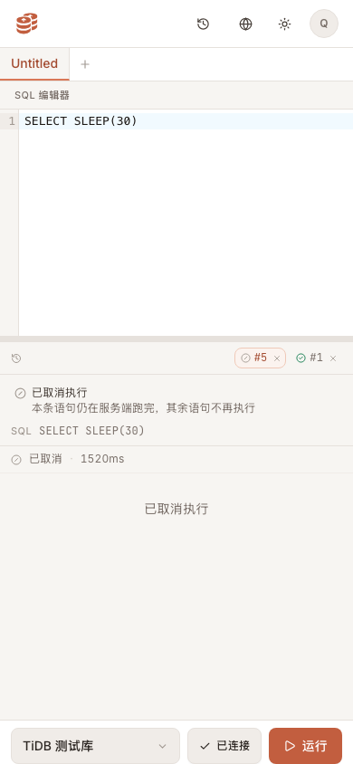

# 取消前端 · 执行按钮运行态 + cancelled 呈现 实测证据

真实浏览器（无头 Chrome，CDP 驱动，1440×900 与 390×844，DPR 1，浅色主题）+ 本地真后端（`wrangler dev` + 本地 D1，SPA 由 worker 托管）。登录、notebook、数据源列表、运行记录列表都是真跑：测试用户与三条数据源（`mysql` / `postgres` / `spark`）是真库行，跑的是真 `/api/databases`、真 `/api/notebooks`。

**桩（取消契约尚未合并，属 #29）**：`POST /api/query` / `POST /api/query/batch` 的响应与 `POST /api/query/cancel` 由 DevTools 协议 `Fetch` 域按冻结契约回放——取消响应 `{ok:true,cancelled:true}`，执行响应带 `cancelled: true` 与该条 `cancelled: true`；请求本身（`executionId` 的形状与取值）由前端真发，被原样抓到。历史路径的 run 行是真库插入的，只有该行的详情响应由桩补上 `cancelled: true`（后端 #29 加的是列，尚未合并）。取消交互、按钮状态、文案与呈现全部是前端真代码。

## 1. 执行按钮运行态（单条 `/query`，TiDB 数据源）

| 状态 | 按钮 |
| --- | --- |
| 运行中 | 文案 `运行`、图标旋转（`animate-spin`）、`aria-busy="true"`、**仍然可点**（`disabled=false`）、悬停 `title="取消执行"` |
| 点击取消后 | 文案 `正在取消…`、`title="正在取消…"`、仍旋转、仍可点 |
| 落定后 | 回到 `运行`、无旋转、无 `aria-busy` |

请求形状（CDP `Network` 抓包）：

| 请求 | 体 |
| --- | --- |
| `POST /api/query` | `{"databaseId":…,"sql":"SELECT SLEEP(30)","notebookId":…,"executionId":"de80b31e-e83e-4be4-a417-d2e6596783dd"}` |
| `POST /api/query/cancel` | `{"executionId":"de80b31e-e83e-4be4-a417-d2e6596783dd"}` —— 与原执行的 `executionId` 逐一相同（uuid 校验通过） |

原执行请求没有被中止：它在取消之后才返回，前端等的就是这份 `cancelled` 响应。

## 2. cancelled 呈现

| 检查项 | 结果 |
| --- | --- |
| 主提示文案（中文） | `已取消执行`（x 16 · y 416 · 1408×34，两行块，在结果区之上、历史条之下） |
| 副提示（TiDB / D1 这类只能停批的引擎） | `本条语句仍在服务端跑完，其余语句不再执行` |
| 语句条 | `已取消` + 耗时（例：`#2 · 已取消 · 1500ms`），不带成功勾 |
| 语句内容区 | 居中 `已取消执行`，不再是「没有返回任何行」 |
| 运行条页签 | 斜杠图标 + 读屏文案 `已取消`，悬停提示里也是 `已取消` |
| halted 行 | 不出现（取消不是错误，不计入「第 n 条语句出错」） |

批量取消（3 条提交，第 2 条被取消）：`/batch` 响应只回 1 条正常 + 1 条 `cancelled: true`，第 3 条从未执行；界面只出现 2 条语句，侧栏 `#1 · 1r · 2ms`、`#2 · 已取消 · 1500ms`，无 halted 行。

PostgreSQL（真杀，`pg_cancel_backend`）：只有主提示 `已取消执行`，**没有副提示**：

历史路径（刷新后从运行记录打开该次运行，记录带 `cancelled: true`）：主提示照样出现、无副提示（记录里没有引擎，所以不声称「仍在服务端跑完」）。

移动端 390×844（底栏执行按钮）：运行中 81×40、取消中 122×40（`正在取消…` 加宽后仍在 390 内），底栏 `scrollWidth === clientWidth === 390`（无横向溢出），主提示与副提示同桌面。

## 3. 自动化

`web` 工作区内：

- `npx vitest run`：22 个文件 / 192 用例全绿（基线 21 个文件 / 176 用例；净增 16 例：`runs.test.ts` +4（`cancelNotice` / `runCancelNotice` / `withCancelling` / 取消落地）、`queryResults.test.tsx` +7（已取消提示与语句标记）、新增 `runActionButton.test.tsx` 5 例）。
- `npx tsc --noEmit`、`npx tsc -b && npx vite build`：干净。
- 仓库根 `npx biome format web/src`、`npx biome lint .`：干净。
- `translations.test.ts` 的键集对等与「UI 用到的键都有定义」覆盖新增的 `query.cancelling`、`results.cancelled*`、`errors.cancel_failed`（中英齐平），并确认 `query.spark_cancel_hint` 已删除（Spark 已改为执行级真杀，旧口径不再成立）。

## 4. 已知边界（等后端 #29 合并后自动补齐）

- 运行条/抽屉里该次运行的图标仍显示成功勾、摘要显示行数：运行记录的 `cancelled` 列由 #29 一并加，前端读的是同一字段（`NotebookRunSummary.cancelled`）；列到位后同一份代码即显示「已取消」。
- 真取消链路（后端真杀、真 `cancelled` 响应）以 #29 合并后重跑本页脚本为准，脚本与断言不变，只需关掉 `Fetch.fulfill` 的回放。
