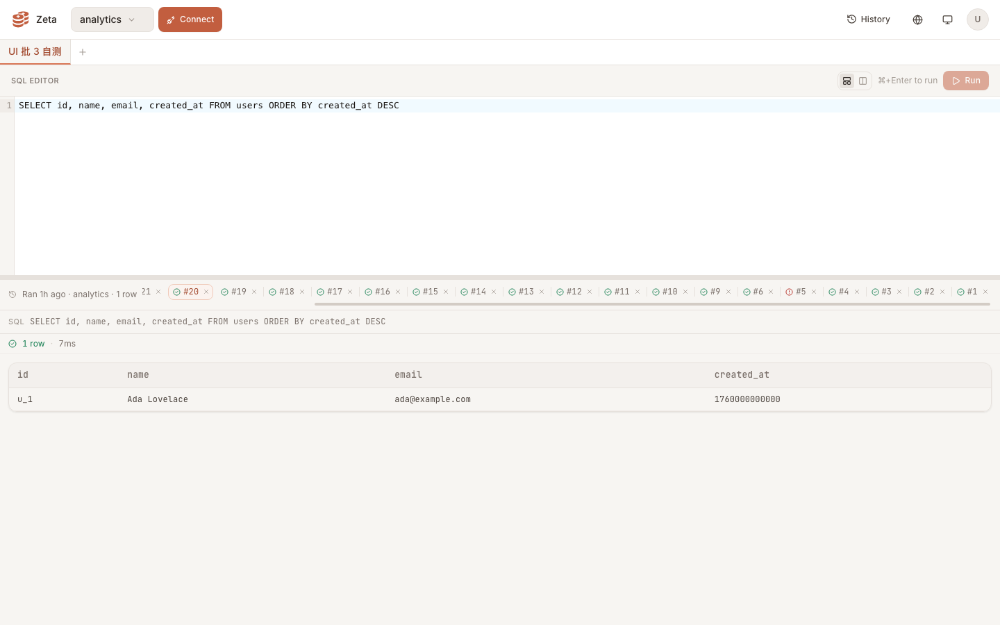
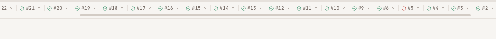
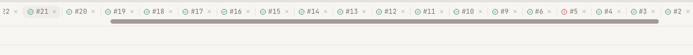
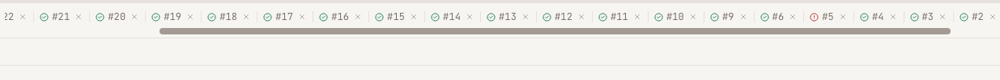
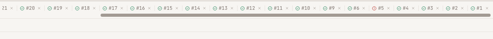
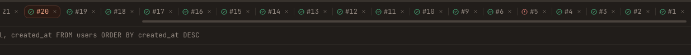
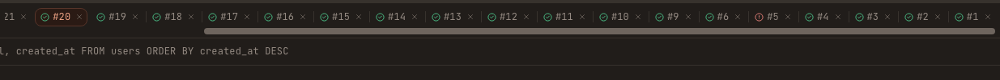
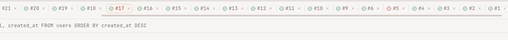

# 运行页签条细线滚动条 + 页签分割线 · 实测证据

真实浏览器（无头 Chrome 158，`--headless=new`，1440×900，DPR 1，**不加 `--hide-scrollbars`**）+ 本地真后端（`wrangler dev` + 本地 D1，SPA 由 worker 托管，登录与运行记录接口都是真跑）。被测数据：notebook 里 23 条真实运行记录（≥12），页签条内容宽 1531px > 可视 1223px，确定横向滚动。指针全部经 DevTools 协议 `Input.dispatchMouseEvent` 真实派发；悬停 = `mouseMoved`（无按键），拖动 = 在滑块上 `mousePressed` 后分步移动、松开前截屏。

截图全部出自提交本文件时的 HEAD（`web/dist` 由该 HEAD 重新构建）；下列数值即从这些 PNG 逐像素复核得出。`::-webkit-scrollbar-thumb` 没有可从 JS 读取的 computed 样式，所以滑块高度以**像素行数**为准。

## 滚动条：静止 4px / 悬停页签条 8px / 轨道全程透明

滚动条占一条**固定 8px 的槽**（`offsetHeight − clientHeight` = 35 − 27 = 8px），不再是原来的覆盖式滚动条（改前同一容器该差值为 0，浮在页签上）。槽里滑块静止 4px、悬停整条页签条时 8px，槽高全程不变 → 悬停增粗不引起任何回流（`clientHeight 27 / offsetHeight 35` 三态同值）。

| 状态 | 指针位置 | 滑块像素行 | 高度 | 颜色（=token） | `--run-strip-thumb-inset` | clientH / offsetH |
| --- | --- | --- | --- | --- | --- | --- |
| 静止 | 页面空白处 | 37–40 | **4px** | `#D3CCC5`（ink-300 浅） | 2px | 27 / 35 |
| 悬停页签 | 页签文字上 | 35–42 | **8px** | `#A29A93`（ink-400 浅） | 0px | 27 / 35 |
| 悬停条内空白 | 条自身留白处 | 35–42 | 8px | `#A29A93` | 0px | 27 / 35 |
| 拖动中 | 按住滑块移动 | 35–42 | 8px | `#A29A93` | 0px | 27 / 35 |
| 暗色 · 静止 | 页面空白处 | 37–40 | 4px | `#4A433D`（ink-300 暗） | 2px | 27 / 35 |
| 暗色 · 悬停页签 | 页签文字上 | 35–42 | 8px | `#6E655E`（ink-400 暗） | 0px | 27 / 35 |

悬停增粗的机制：Chrome 绘制自定义滚动条只认「元素自身在 `:hover` 里有没有声明变化」——只写 `:hover::-webkit-scrollbar-thumb` 规则不会触发重绘（实测悬停页签时滑块停在 4px）。所以滑块内缩量做成元素上的继承变量 `--run-strip-thumb-inset`，在 `.run-history-scroll:hover` 里翻成 0px；`index.css` 该段的注释记录了这一行为与实测依据。拖动态（`::-webkit-scrollbar-thumb:active`）单独写死 `border-width: 0`，不依赖悬停。

**轨道透明**：三种状态下，8px 槽的每一行像素都只有两种颜色——滑块色与页面底色 `rgb(247,245,242)`，没有任何轨道色块（拖动态同样，见 `-drag.png`）。CSS 侧 `::-webkit-scrollbar-track` / `:hover` / `:active` / `::-webkit-scrollbar-corner` 四条规则均为 `background: transparent`，由 `runHistoryBar.test.tsx` 钉住。

**不遮内容**：滚动容器底 441.8px，其下方 SQL 头行顶 446.8px（间隙 5px）；截图裁剪带里 8px 槽（行 35–42）之下、行 43–46 全是页面底色，SQL 文字从行 58 起，完整可读，无任何压盖。

## 页签分割线：1px × 14px，ink-200，首尾无、选中相邻无双线

| 检查项 | 实测 |
| --- | --- |
| 尺寸 | 宽 1px（单列像素）× 高 14px（裁剪图行 14–27），页签盒 22.8px 内垂直居中 |
| 颜色 | `#E6E1DC`（ink-200 浅；暗色为 `#37322D`） |
| 位置 | 每根线落在相邻页签的 4px 间距里，两侧各留 ~2px；线与线间距 69px = 页签间距 |
| 数量 | 可见 16 根，全部在相邻页签之间；第一个之前、最后一个之后没有 |
| 选中相邻 | 选中页签（图中第 9 个）自己那侧与其后一个页签那侧的线不生成：两线之间出现 207px = 3×69 的洞；DOM 侧 `getComputedStyle(选中页签, '::before').content === 'none'`、其后一个同为 `'none'`、其前一个为 `'""'` |
| 跟随 | 线是页签盒自身的 `::before`，页签增删/横滚时跟随，无残线 |

## 行为不回归

| 操作 | 实测 |
| --- | --- |
| 点击页签 | 选中切换（点中的页签成为 `aria-selected="true"`，高亮随之移动），8px 槽不变 |
| 拖动滑块 | 条随拖动滚动（`scrollLeft` 200 → 308） |
| 滚轮/横向滚轮/键盘/删除页签 | 2026-11-13 同环境实测：竖直滚轮使条横滚（0→120）、横向滚轮反向（120→40）、`ArrowRight` 切换选中、页签 × 删除后 24→23 且无残线；本单对这些代码零改动（diff 只含样式与样式契约测试） |

## 复现方式

1. 构建：`cd web && npx tsc -b && npx vite build`。
2. 起 worker：`worker/.dev.vars` 写 `JWT_SECRET`/`SETUP_SECRET`/`ENCRYPTION_KEY`（随机值），`cd worker && npx wrangler dev --ip 127.0.0.1 --port <空闲> --persist-to <独立目录> --var APP_URL:http://127.0.0.1:<port>`。
3. 初始化与数据：`POST /api/setup`（带 SETUP_SECRET）→ 注册首用户（admin）→ 在 `--persist-to` 下的 D1 sqlite 里 `UPDATE zeta_users SET email_verified = 1` 并写入已知 pbkdf2 口令哈希（`pbkdf2:100000:<saltHex>:<hashHex>`，SHA-256、100k 轮）→ 向 `zeta_notebook_runs` 插 ≥12 行（真实接口 `GET /api/notebooks/:id/runs` 直接读这些行）。
4. 起 Chrome：`--headless=new --remote-debugging-port=<空闲> --user-data-dir=<独立目录>`（**不要**带 `--hide-scrollbars`，否则滚动条整体不绘制）。
5. CDP：连 `/json/list` 里 `type === 'page'` 的目标；`Emulation.setDeviceMetricsOverride` 1440×900 DPR 1；页面内 `fetch('/api/auth/login')` 拿会话后导航 `/query`，等 `[role="tablist"][aria-label] [role="tab"]` ≥ 12。
6. 量法：`offsetHeight − clientHeight` 定位 8px 槽；`Page.captureScreenshot` 带 clip 截页签条（含下方一行），对槽内逐行数「与滑块 token 色差 ≤6」的像素行数即滑块高度；轨道透明 = 该 8 行里除滑块色外只有页面底色。悬停/拖动用 `Input.dispatchMouseEvent`（拖动要在 `mousePressed` 与 `mouseReleased` 之间截屏）。
