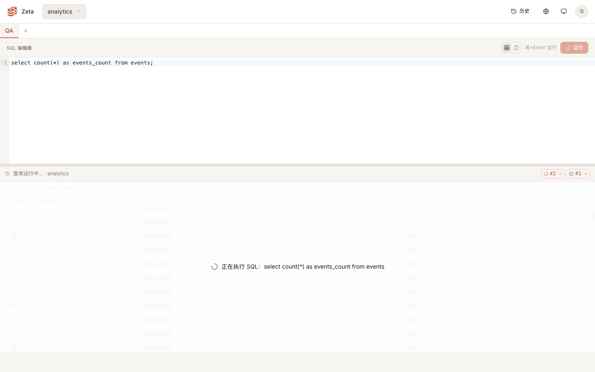
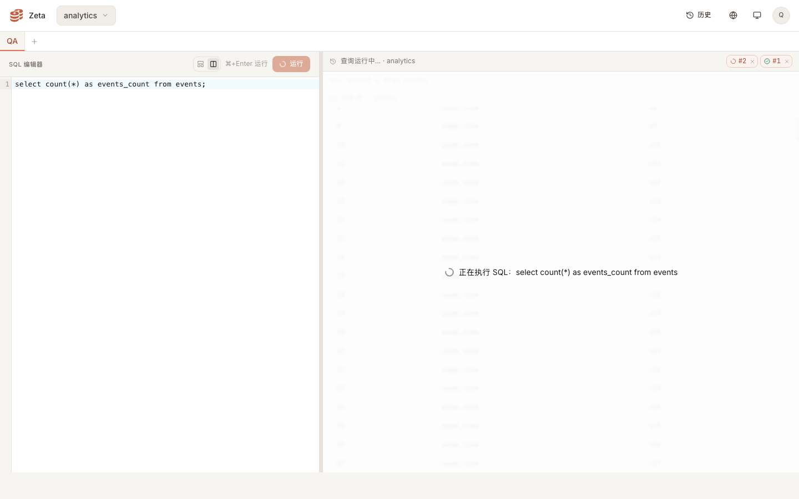
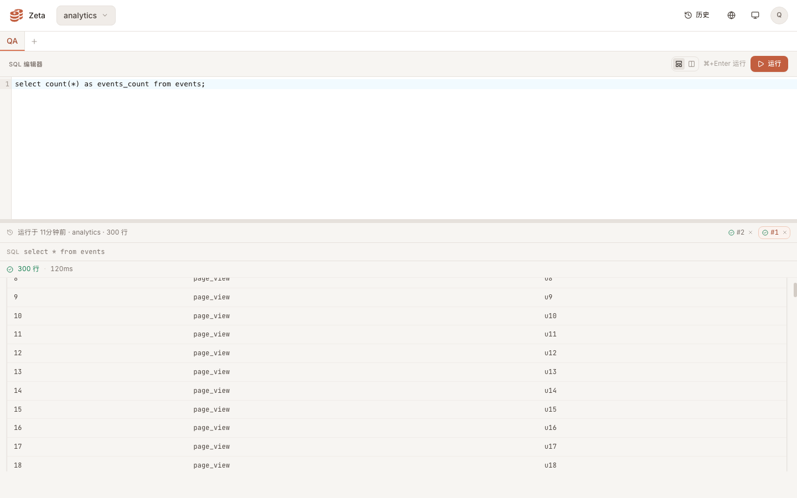
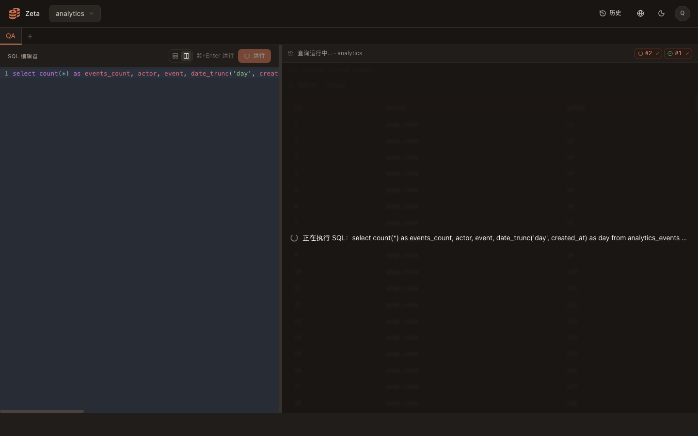
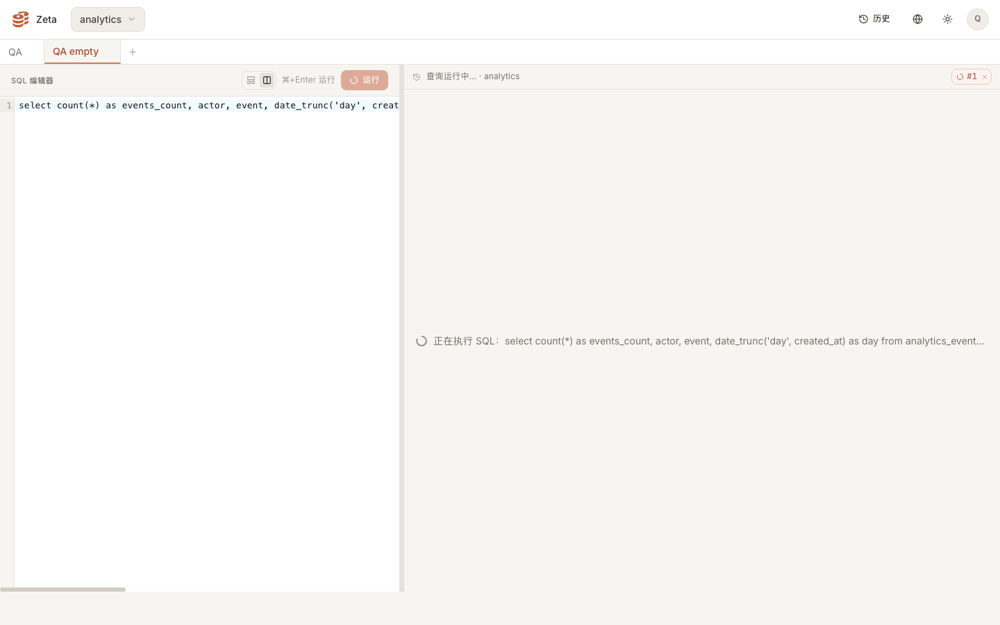

# 结果面板运行态遮罩 · 实测证据

真实浏览器（无头 Chrome，1440×900，DPR 1）+ 本地真后端（`wrangler dev` + 本地 D1，SPA 由 worker 托管）。慢查询是造出来的：DevTools 协议 `Fetch` 域把 `/api/query` 先挂住、约 3 秒后再回包；登录、notebook、运行记录、结果接口都是真跑。

被测数据：notebook 里已有一条 300 行结果的运行记录，表格滚动到 `scrollTop = 300`。

## 遮罩覆盖范围（红框全覆盖）

| 检查项 | 上下分屏 | 左右分屏 |
| --- | --- | --- |
| 遮罩矩形 | x 0 · y 439 · 1440×413 | x 582 · y 129 · 858×723 |
| 结果面板矩形 | 与遮罩完全一致（`inset-0`） | 与遮罩完全一致（`inset-0`） |
| SQL 头行所在点命中的元素 | 遮罩 | 遮罩 |
| 记录条矩形 | y 409 · 119×23（在遮罩上边界之上） | y 99 · 119×23（在遮罩上边界之上） |
| 临时页签 X 所在点命中的元素 | 取消按钮的图标 | 取消按钮的图标 |
| `role="status"` 数量 | 1 | 1 |
| 遮罩文案 | 正在执行 SQL：select count(*) as events_count from events | 同左 |

截图里除记录条与遮罩那行字外，读不到任何旧内容（含 SQL 头行 `SQL select * from events` 与元信息行 `300 行 · 120ms`）。





## 结束与取消

| 路径 | 表格行数 | 滚动位置 | 遮罩 | 记录条 |
| --- | --- | --- | --- | --- |
| 运行前 | 300 | 300 | — | 运行于 3 分钟前 · analytics · 300 行 |
| 运行中 | 300（旧结果不卸载） | 300 | 在 | 查询运行中… · analytics + 临时页签 `#2` + X |
| 结束 | 400（新结果就地显示，表头 `events_count`、元信息 `400 行 · 1234ms`） | 300 | 消失 | 运行于 刚刚 · analytics · 400 行 |
| 取消（先选回 `#1` 再跑再取消） | 300（旧结果原样恢复，头行回到 `select * from events`、元信息 `300 行 · 120ms`） | 300 | 消失 | 回到 `#1` 的成功态 |



## 深色主题 + 长 SQL（单行截断）

左右分屏（结果栏最窄）、深色主题、241 字符的单条 SQL：

- 遮罩文案截断为单行：`scrollWidth 1652 > clientWidth 800`，`text-overflow: ellipsis`、`white-space: nowrap`、`overflow: hidden`，行高测得 1 行；
- 文案右缘 x 1424，遮罩右缘 x 1440（左右各 16px 内边距），没有越过面板；
- `title` 携带完整 249 字符文案，悬停可读全文；
- 遮罩背景 `bg-ink-0/90`（深色主题下解析为 90% 不透明度的 `--color-ink-0`）+ `backdrop-blur(2px)`，旧内容不可读；截图里旧表格文字未被识别。



## 首跑（没有旧结果）的空状态

另一个从没跑过的 notebook、241 字符单条 SQL：没有表格，居中提示与遮罩同款文案，同样是单行截断——`scrollWidth 1610 > clientWidth 800`、`text-overflow: ellipsis`、行高 1 行、右缘 x 1424 未越过 1440。



## 多语句文案

同一环境把 notebook 换成三条语句后执行，遮罩文案为：

```
正在执行 SQL：select count(*) as events_count from events（共 3 条）
```

`title` 与显示文案一致（完整文案）。

## 自动化

`web` 工作区内：`pnpm test` 73 项全绿（新增遮罩出现/结束消失/取消消失/多语句文案/首跑提示用例），`pnpm type-check` 干净，仓库 `pnpm format:check` 与 `pnpm lint` 干净。
