# 吸底保存栏 · 视觉与交互验收实测证据

被测提交：`a9f4203`（PR #222，含 `c3a50b6` 实现 + `feb716b` 修复）——已合入 `main`；`a9f4203..origin/main` 的后续提交未触及 `StickySaveBar.tsx` / `AdminSettings.tsx` / `index.css` / `translations.ts`，本次结论对当前 `main` 同样成立。

环境：真浏览器（无头 Chrome `158.0.8127.37`，Playwright `1.65.1`，桌面 1440×900 DPR1、移动 393×852 DPR2 模拟 iPhone 14 Pro）+ 真后端（`wrangler dev` + 本地 D1，`PATCH /api/admin/settings` 真发真落库）+ 真前端（Vite 开发服务器，`/api` 代理到 worker）。管理员账号是本地真注册的真账号。

**桩（唯一一处）**：为观测「保存中」这一中间态，测试在 `PATCH /api/admin/settings` 的响应上人为延迟 1.5–1.8 s；失败态用同一条路由直接 abort 模拟断网。除此之外无任何打桩：页面渲染、脏判定、请求体、落库、状态文案全部是产品真代码真行为。

## 验收结论

| # | 标准 | 结论 | 关键证据 |
| --- | --- | --- | --- |
| 1 | 保存入口为吸底栏，滚动时始终位于视口底部并可见 | **通过** | 桌面/移动各 5 个滚动位置，栏底恒等于滚动容器底（900 / 852），`position: sticky` |
| 2 | 保持统一保存语义，不拆分保存 | **通过** | 跨「通用」「查询结果保留」两处改动只产生 **1 个** `PATCH /api/admin/settings`，请求体同时带两处字段，且两处一并落库 |
| 3 | 全页仅一个保存入口，顶部按钮已移除 | **通过** | 全页含「保存」的按钮仅 1 个（吸底栏内）；页头 3 个按钮无保存项；旧版标题行保存按钮在 `a9f4203` 中已删除 |
| 4 | 吸底栏不遮挡内容，滚到底后末项完整可见、可操作 | **通过** | 滚到底净空：桌面 95.6px、移动 79.7px；末项「测试邮件」卡片完整可见，其末控件在视口内且不与栏重叠、可聚焦/可点按 |
| 5 | clean disabled / dirty enabled / saving disabled 防重复 / saved 后复位，桌面与移动端一致 | **通过** | 桌面与移动四态文案与 `disabled` 逐一相同；保存中重复点击只发出 1 个 PATCH |

**总计 20 项断言，20 项通过，0 项失败。**

## 1. 吸底常驻（标准 1）

滚动容器是 `main`（`AdminLayout` 的 `main.flex-1.overflow-auto`），吸底栏是页面末尾的 `section.sticky.bottom-0`。

| 位置 | 桌面：栏底 / 容器底 | 移动：栏底 / 容器底 | 移动栏 padding-bottom |
| --- | --- | --- | --- |
| 0% | 900 / 900 | 852 / 852 | 34px |
| 25% | 900 / 900 | 852 / 852 | 34px |
| 50% | 900 / 900 | 852 / 852 | 34px |
| 75% | 900 / 900 | 852 / 852 | 34px |
| 100% | 900 / 900 | 852 / 852 | 34px |

五个位置全部 `bar.bottom === main.bottom`，且整栏落在视口内（`bar.top ≥ 0`、`bar.bottom ≤ viewportHeight`）。

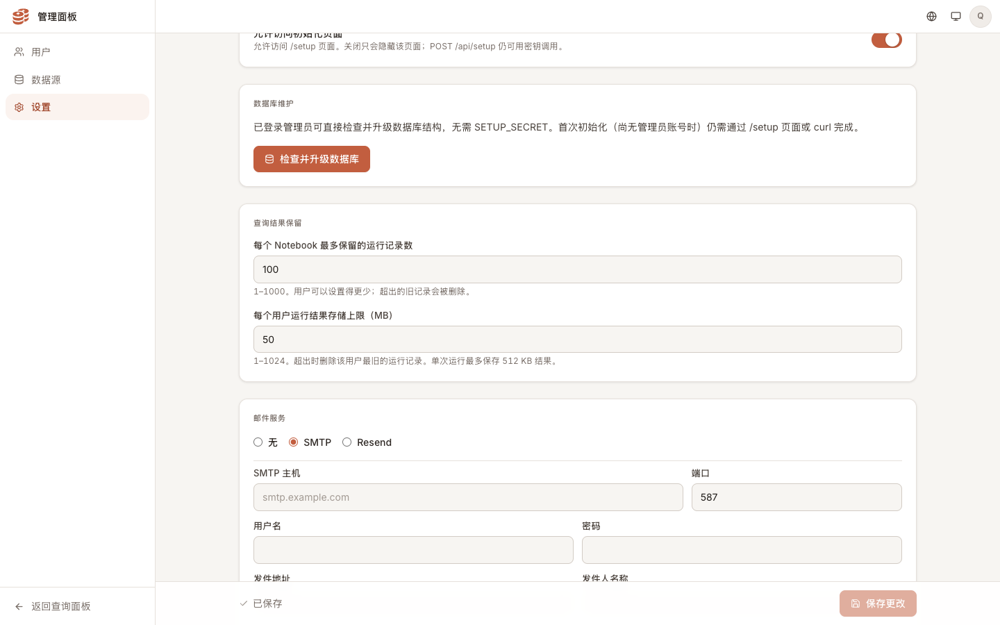

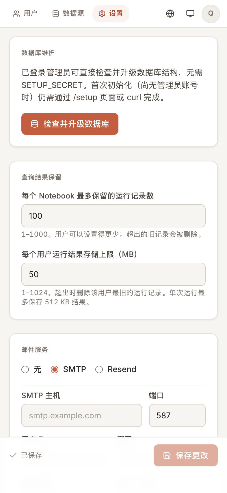

## 2. 移动端 safe-area（标准 1 / 4）

safe-area 的归因先单独证明过：设备尺寸模拟本身不产生 inset（`Emulation.setDeviceMetricsOverride` 后 `env(safe-area-inset-bottom)` 仍是 `0px`），只有 `Emulation.setSafeAreaInsetsOverride` 注入后 `env()` 才变成 `34px`——即下面的 34px 来自刘海屏 home indicator 区，而不是设备尺寸副作用。

| 检查项 | 结果 |
| --- | --- |
| `viewport-fit=cover` | 页面 meta 含 `viewport-fit=cover` |
| 注入 34px 后 `env(safe-area-inset-bottom)` | `34px` |
| 吸底栏 computed `padding-bottom` | `34px`（`.safe-b` → `env(safe-area-inset-bottom)`） |
| 吸底栏 class | `sticky bottom-0 z-(--z-sticky-bar) … safe-b` |
| 保存按钮底 → 栏底间距 | `46px`（≥ 34px，按钮落在 inset 区**之上**，不被 home indicator 挡住） |
| 五个滚动位置 padding-bottom | 恒为 `34px`（安全区内边距始终在，不会随滚动丢失） |

红色斜纹带是测试注入的可视化标记，标出 34px 的 inset 区；吸底栏的底色延伸进该区，而状态文案与「保存更改」按钮被顶到 inset 区之上。

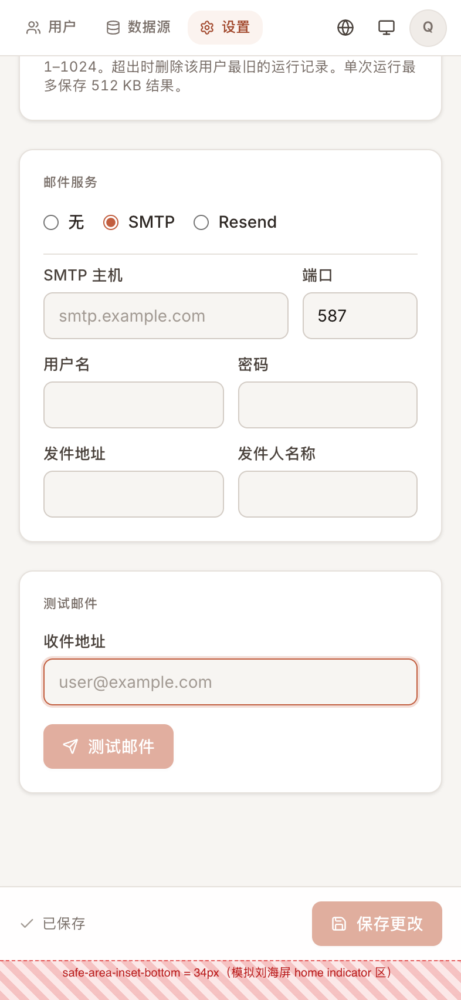

## 3. 唯一保存入口（标准 3）

| 检查项 | 桌面 | 移动 |
| --- | --- | --- |
| 全页含「保存」的按钮 | `["保存更改"]`（仅 1 个，在吸底栏内） | 1 个 |
| 吸底栏内按钮数 | 1 | 1 |
| 页头按钮 | `["", "", "Q"]`（语言/主题/账号，无保存） | 同上 |
| 吸底栏定位 | `position: sticky` | `position: sticky` |

代码层对照：`a9f4203^` 的 `AdminSettings.tsx` 在标题行有 `<button … onClick={save}>`，即顶部保存按钮；`a9f4203` 删掉了它，改为页面末尾挂 `<StickySaveBar … onSave={() => void save()} />`。

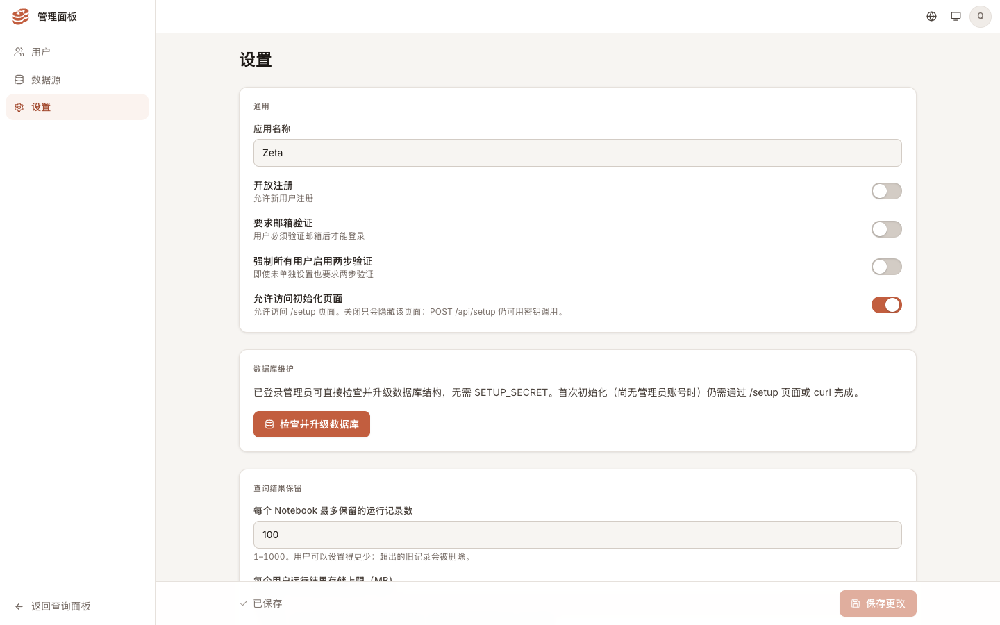

## 4. 统一保存语义（标准 2）

同一次改动跨两个分区（「通用 → 应用名称」+「查询结果保留 → 每个 Notebook 最多保留的运行记录数」）：

| 检查项 | 结果 |
| --- | --- |
| 保存窗口内的非 GET 请求 | 只有 `PATCH /api/admin/settings`（1 个） |
| 请求体 | 同时含 `app_name:"Zeta QA"` 与 `notebook_run_limit:"123"`（另含未改动字段，服务端整体落库） |
| D1 落库 | `app_name=Zeta QA`、`notebook_run_limit=123`（直接读本地 D1 表 `zeta_settings`，非前端回显） |
| 拆分保存 | 无：页面内不存在分区的独立保存按钮 |

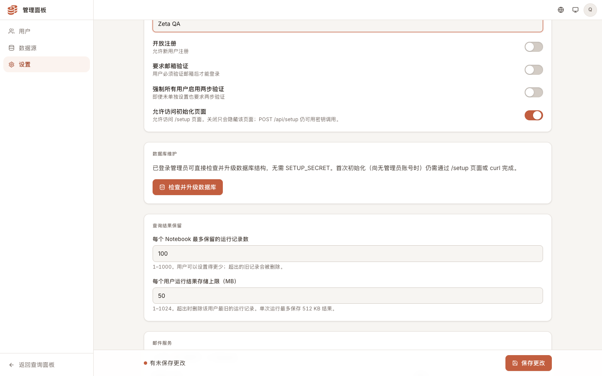

## 5. 滚到底：末项完整可见、可操作（标准 4）

末项为「测试邮件」卡片（本地设置 `email_provider=smtp`，该卡片存在）。

| 检查项 | 桌面 | 移动 |
| --- | --- | --- |
| 末项卡片标题 | 测试邮件 | 测试邮件 |
| 卡片底 → 栏顶净空 | 95.6px | 79.7px |
| 卡片与栏是否重叠 | 否 | 否 |
| 末控件（卡片最后一个按钮「测试邮件」）位置 | top 683 / bottom 720.7，在视口内 | top 617.0 / bottom 654.7，在视口内 |
| 末控件与栏是否重叠 | 否 | 否 |
| 可操作性 | 焦点可落到收件地址输入框（`#test-email-to`） | 点按可聚焦到 `#test-email-to`（触屏 `tap`） |

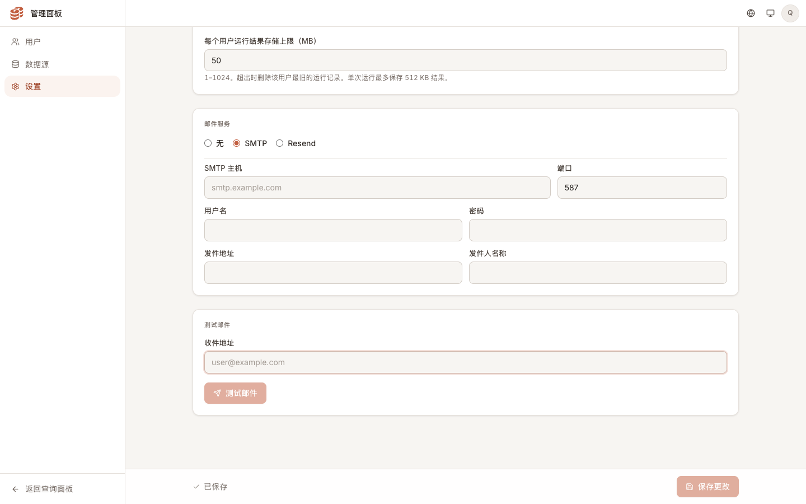

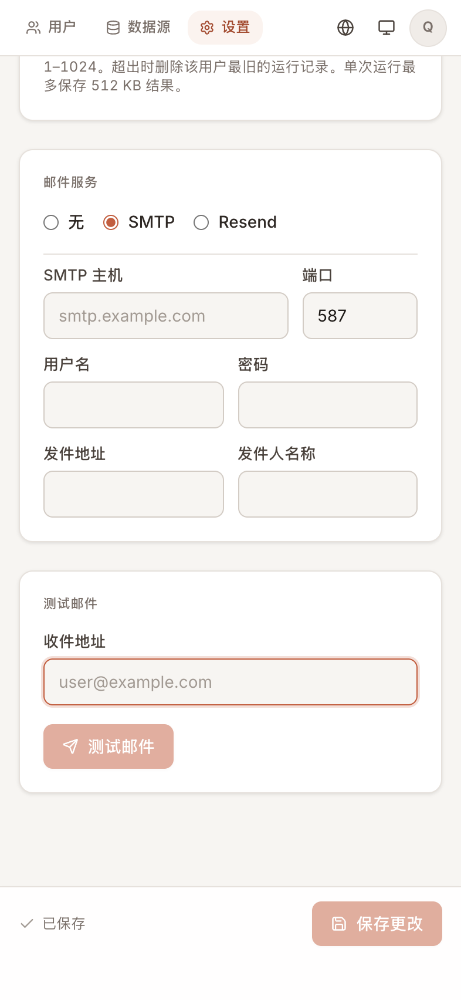

## 6. 保存状态四态（标准 5）

桌面与移动端逐字一致：

| 状态 | 文案 | 按钮 `disabled` |
| --- | --- | --- |
| clean（初始 / 保存成功后复位） | `已保存` | `true` |
| dirty | `有未保存更改` | `false` |
| saving | `保存中…` | `true` |
| saved（刚落库那一瞬） | `已保存！` | `true` |

- **防重复**：保存中（按钮已禁用）再次点击按钮，`PATCH` 计数仍为 **1**。
- **复位**：成功约 3 s 后回到 `已保存` + 禁用。
- **脏判定覆盖面**：文本框（应用名称）改值、切单选（邮件服务商 SMTP→Resend）都进 dirty；把单选改回基线值即回 clean（说明 dirty 是与基线比较，不是单向标志）。
- **失败态**（额外测，不在五条标准内）：断网（PATCH abort）后栏内出现 `role="alert"` 红色提示，按钮恢复可用，未保存的改动不丢。

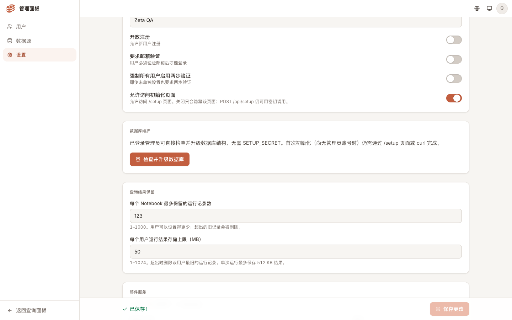

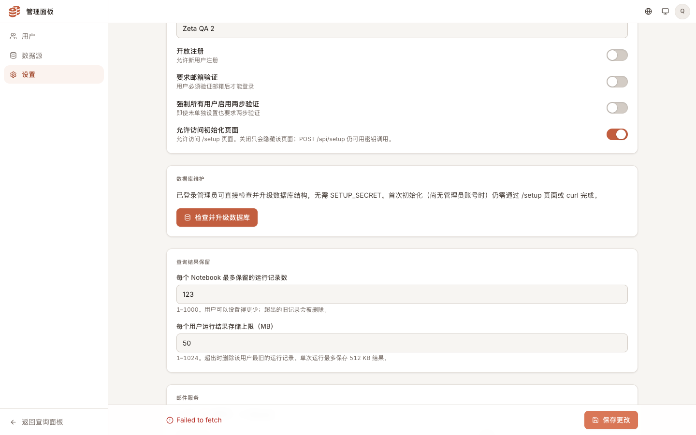

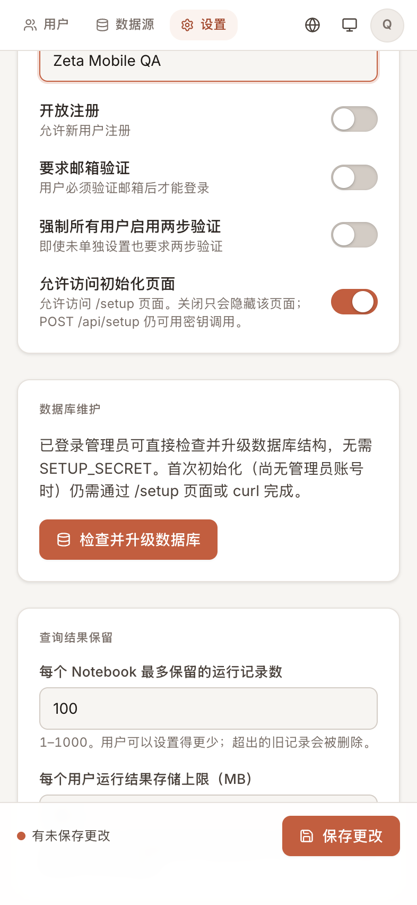

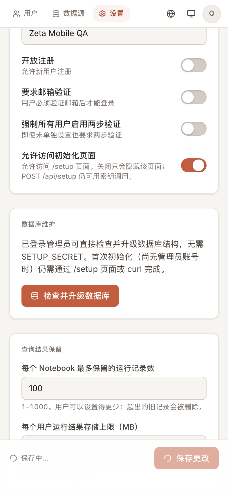

## 附带观察（非阻塞，不影响上述结论）

1. **失败提示未本地化**：断网时栏内提示是浏览器原始英文 `Failed to fetch`，不是产品文案。属 i18n 打磨项，五条标准未涉及。
2. **栏体半透明**：`bg-ink-0/95 + backdrop-blur-sm`，滚动中栏下内容会透出（真实浏览器下由 backdrop-blur 模糊；本次 headless 截图未渲染出模糊效果）。不影响末项可达性——内容容器有 `pb-20 sm:pb-24` 底部留白，滚到底仍有 79.7px（移动）/ 95.6px（桌面）净空。

## 自动化与回归

- `web` 工作区 `npx vitest run`：**35 个文件 / 358 个用例全绿**（含本次 PR 新增的 `stickySaveBar.test.tsx`、`adminSettings.test.tsx`）。
- 本次验收全程未改动产品源码：`git status --porcelain` 仅新增本目录下的 QA 报告与截图。

## 复现

- 脚本：`/tmp/zeta-qa/qa.js`（Playwright 1.65.1 + 系统 Chrome 158），结果 `/tmp/zeta-qa/results.json`，截图 `/tmp/zeta-qa/shots/`。
- 复现顺序：干净克隆 → `pnpm install` → `worker/` 下 `wrangler dev`（本地 D1，`POST /api/setup` 初始化）+ `web/` 下 `pnpm dev` → 注册管理员 → `cd /tmp/zeta-qa && node qa.js`。
- 本次实测跑在本地真栈：worker `wrangler dev`（8787）+ Vite（5173，`/api` 代理），管理员账号 `qa-admin@zeta.local`（本地 D1 真注册）。
